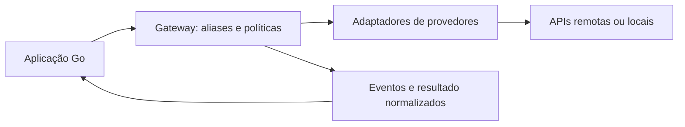

# ADR: Biblioteca AI Gateway em Go

Status: accepted — implementação incremental
Mode: Integrate
Date: 2026-10-30

## Contexto

O objetivo é distribuir uma biblioteca Go reutilizável entre projetos. No início do planejamento, o repositório continha apenas o documento `Regras_provedores_gateway_unificado.docx`, que descreve integrações existentes no Thoth. Posteriormente, por orientação do usuário, o código local do Thoth e suas fixtures foram consultados para conferir os formatos Samsung/Gauss.

O usuário aceitou os contratos e autorizou o núcleo e os adaptadores OpenAI Compatible, Anthropic, Gauss e Samsung Agent Builder. O estado implementado está em [ARCHITECTURE.md](../../ARCHITECTURE.md); este ADR mantém o plano mais amplo. Contexto automático, cotas distribuídas, hooks gerais e ferramentas em streaming ainda não estão implementados. IDs válidos/únicos recebidos do upstream são mantidos sem um segundo namespace.

Na implementação Anthropic, a base é normalizada para aceitar raiz e `/v1` final em chat e catálogo, resolvendo a divergência original. O catálogo já inclui paginação limitada. O perfil é fixado em `2023-06-01` para preservar o contrato de parâmetros descrito no documento; mudanças de versão da API devem ser tratadas explicitamente.

Gauss reutiliza a implementação OpenAI por transporte privado, com snapshot nativo, três IDs e cota local compartilhada. Após consultar o Thoth, foram corrigidos traduções em lista, rótulos com `-`, envelopes e timestamp específico de cooldown; seu framing por linha também é normalizado. `provider_wait` foi acrescentado sem mudar interfaces de operação. A fixture original de catálogo foi incorporada aos testes, sem validar o deployment por chamadas reais.

Agent Builder usa as respostas buffered/NDJSON verificadas em `llm/samsung.go` e `samsung_stream_test.go` do Thoth. Preserva sessões por chamada em `ChatResult.SessionID`, sem reuso; zero explícito é transmitido. Parâmetros sem componente LLM e frames malformados falham explicitamente; texto final divergente mantém o parcial e retorna erro. Essas decisões corrigem descartes ou substituições silenciosas do legado.

Esta proposta distingue comportamento legado de decisões da biblioteca nova. Samsung/Gauss têm testes com formatos conferidos no Thoth; validação no ambiente real permanece pendente. A janela de três chamadas por minuto do Gauss é política do documento, não garantia comercial do fornecedor.

## Decisão proposta

Atualização de 2026-10-31: por orientação do usuário, a política de tokens implementada é opcional por alias, com janela explícita, contador estimado padrão ou personalizado pelo consumidor e rejeição de entrada + orçamento de saída que ultrapasse o limite. Não remove mensagens automaticamente. O padrão opcional de saída é transmitido ao provedor; na ausência dele, a requisição precisa informar `MaxOutputTokens`. Contador omitido usa `EstimateInputTokens`, uma heurística por bytes UTF-8 e overhead fixo de mensagens/ferramentas. Pode superestimar ou subestimar; não é contagem exata ou limite superior garantido, e não preenche uso reportado. Um contador personalizado tem prioridade. `SafetyMarginTokens` reserva margem fixa configurável e `SafetyMarginPercent` reserva `ceil(entrada * percentual / 100)`, ambas com padrão zero, para estimativas ou contadores personalizados. O percentual é inteiro não negativo e incide somente sobre a entrada. Entrada + saída + margem fixa + margem percentual precisa caber na janela; a margem não é enviada ao provedor nem modifica contagens ou uso. Rejeições locais de contexto expõem `Error.TokenBudget` com contagens, saída reservada, margens, total e janela; valores indisponíveis e overflow são explícitos, sem conteúdo de mensagens. Erros remotos e falhas de contagem não recebem orçamento local. Não há tokenizer ou descoberta de janela. Esta decisão substitui as propostas de corte automático e de reserva separada do limite transmitido nas seções de planejamento abaixo. A descrição da API efetiva está no [README](../tokens.md).

Criar um módulo Go com uma fachada `Gateway` e adaptadores importáveis separadamente. Cada aplicação instancia os provedores necessários, registra deployments e resolve aliases de modelos. HTTP é usado para falar com os provedores; o consumidor chama funções Go diretamente.



Responsabilidades da biblioteca:

- Traduzir mensagens, parâmetros, ferramentas e respostas.
- Gerar texto com e sem streaming, quando suportado.
- Gerar embeddings e descobrir modelos, quando suportado.
- Aplicar políticas de contexto e admissão de chamadas.
- Normalizar erros, uso e término sem apagar o significado nativo.
- Oferecer pontos de integração para métricas e limitação de chamadas.

Responsabilidades da aplicação:

- Buscar e guardar credenciais, inclusive sua criptografia em repouso.
- Guardar histórico, montar RAG e executar ferramentas.
- Escolher aliases, permissões por usuário/projeto e política de retenção.
- Persistir catálogo, uso ou auditoria quando necessário.
- Coordenar limites entre processos quando compartilhar credenciais.

## Alternativas consideradas

1. Serviço HTTP como produto inicial: atende várias linguagens e centraliza segredos/cotas, mas adiciona implantação, autenticação e disponibilidade próprias. Adiado conforme a intenção atual de distribuir uma biblioteca.
2. Apenas clientes separados por provedor: tem menos coordenação, mas repete seleção, contexto, erros e contabilização nos consumidores. Os adaptadores continuam utilizáveis, com a fachada comum como caminho recomendado.
3. Biblioteca com banco, servidor e execução de agentes embutidos: aumenta dependências e acopla o consumidor a decisões que pertencem à aplicação. Fora da primeira entrega.

## Estrutura proposta

```text
ai-gateway/
├── go.mod
├── gateway.go              # composição, deployments e resolução de aliases
├── provider.go             # interfaces pequenas por capacidade
├── request.go              # mensagens, parâmetros e chamadas de ferramenta
├── result.go               # resultado, uso e motivos de término
├── stream.go               # eventos e contrato de entrega
├── errors.go               # erros estruturados e classificação
├── policy.go               # contexto, parâmetros e admissão
├── providers/
│   ├── openai/             # OpenAI e perfil explicitamente compatível
│   ├── anthropic/
│   ├── samsung/            # Agent Builder / Langflow
│   └── gauss/
├── internal/
│   ├── transport/          # clientes HTTP isolados, TLS e política de rede
│   ├── stream/             # framing SSE e NDJSON com limites
│   └── openaiwire/         # tradução compartilhável com Gauss
├── examples/
│   ├── chat/
│   ├── streaming/
│   └── embeddings/
├── testdata/               # respostas e streams sem credenciais reais
├── PRODUCT.md
└── docs/decisions/
```

A árvore será criada conforme cada parte for implementada; não criar pacotes vazios. Começar com biblioteca padrão (`net/http`, `context`, `encoding/json`) e adicionar dependências apenas quando houver uma necessidade concreta.

Direção de dependências: aplicações importam o pacote raiz e os adaptadores escolhidos; adaptadores importam os contratos do pacote raiz; o pacote raiz não importa os adaptadores. A aplicação faz o registro explícito, evitando ciclos e registros globais por `init()`.

O módulo deve ter um caminho de importação estável e tags de versão semântica. Publicar versões `v0.x` enquanto o contrato estiver sendo estabilizado. Não definir agora uma versão mínima de Go sem conferir as ferramentas e os consumidores.

## Contratos Go: desenho preliminar

Operações públicas propostas:

| Operação | Responsabilidade |
|---|---|
| `Chat(ctx, request)` | Uma geração completa; pode devolver chamadas de ferramentas |
| `Stream(ctx, request, emit)` | Eventos incrementais com backpressure e resultado final |
| `Embed(ctx, request)` | Vetores validados e uso, quando disponível |
| `ListModels(ctx, deployment)` | Descoberta explícita de modelos e capacidades |

São nomes de desenho, não uma API já implementada. Os tipos de entrada de chat e embeddings serão distintos. As interfaces dos provedores também devem ser pequenas por capacidade: chat, streaming, embeddings e catálogo. Falta de implementação retorna `unsupported_capability`; não obriga cada adaptador a simular todos os recursos.

### Extensibilidade: entrada comum e capacidades opcionais

O usuário solicita que novos provedores possam ser adicionados futuramente por um contrato comum. A proposta é uma interface base `Provider`, usada no registro, com interfaces adicionais para operações opcionais. Todos os contratos e tipos necessários para implementar um adaptador externo ficam no pacote público; nenhum adaptador externo precisa importar `internal` nem alterar um `switch` de vendors no núcleo.

Esboço de interfaces, ainda sujeito à estabilização dos tipos:

```go
type Provider interface {
    Capabilities(model string) Capabilities
}

type ChatProvider interface {
    Provider
    Chat(context.Context, ChatRequest) (ChatResult, error)
}

type StreamProvider interface {
    Provider
    Stream(context.Context, ChatRequest, func(Event) error) (ChatResult, error)
}

type EmbeddingProvider interface {
    Provider
    Embed(context.Context, EmbedRequest) (EmbedResult, error)
}

type CatalogProvider interface {
    Provider
    ListModels(context.Context) ([]Model, error)
}
```

`Capabilities` consulta configuração ou snapshot local, sem acesso à rede. Estados desconhecidos permanecem desconhecidos. A interface implementada informa que o adaptador conhece a operação; a capacidade por modelo informa se aquele modelo pode executá-la. Implementar `ChatProvider` não significa que todo modelo aceita ferramentas.

O núcleo usa as interfaces para despachar operações. Se a interface estiver ausente, ou se o modelo tiver suporte explicitamente negado, devolve `unsupported_capability` antes da chamada remota. Capacidade desconhecida só pode ser tentada quando houver implementação da operação, sob política explícita. Nenhuma capacidade deve ser promovida a suportada apenas porque existe um método.

Exemplo conceitual de composição de um adaptador externo já configurado:

```go
gw, err := gateway.New(gateway.Config{
    Deployments: map[string]gateway.Provider{
        "provedor-interno": meuProvedor,
        "local":            openAICompatible,
    },
    // Aliases e políticas também são fornecidos na construção.
})
```

O nome no mapa identifica o deployment, não a família do fornecedor. Várias instâncias do mesmo adaptador podem ter bases e credenciais diferentes. O registro acontece na construção, preservando a configuração imutável proposta. Inicialização valida implementações e declarações de capacidade contraditórias, sem sondagens remotas implícitas.

Para adicionar um provedor: implementar a interface base e as operações suportadas, traduzir para os tipos públicos, registrar a instância no consumidor e validar o contrato com fixtures. A inclusão não exige alteração do gateway nem publicação de uma nova versão do núcleo se os contratos existentes forem suficientes.

Alternativa considerada: uma única interface obrigatória com chat, streaming, embeddings e catálogo. Foi preterida nesta proposta porque exige métodos sem implementação real e porque acrescentar uma operação obrigatória quebraria todos os provedores externos. Interfaces opcionais permitem acrescentar operações preservando a interface base. A fachada `Gateway` continua oferecendo uma API uniforme ao consumidor.

Mudanças incompatíveis nos contratos públicos seguem versionamento semântico. Novas capacidades devem preferir novas interfaces opcionais; alterações em métodos existentes exigem planejamento de compatibilidade. Não incluir carregamento dinâmico via `plugin` do Go na primeira versão: adaptadores externos são dependências normais do módulo consumidor.

`Gateway` recebe deployments e aliases na construção. Exemplo conceitual:

```text
alias "chat-local"     -> deployment "ollama-dev" via OpenAI Compatible + modelo local
alias "chat-principal" -> deployment "gauss-corp" + GUID selecionado
alias "embedding"      -> deployment "embedding-api" + modelo remoto selecionado
```

Deployment identifica uma conexão configurada; vendor identifica a integração; protocolo identifica o formato remoto; modelo identifica o recurso selecionado. No Samsung, o modelo é um fluxo. No Gauss, GUID, routing ID e serving ID permanecem separados.

Aliases não criam fallback automático. A escolha deve ser explícita, particularmente em embeddings, onde trocar modelo pode mudar o espaço vetorial.

Uma requisição de chat deve conter mensagens, sistema, ferramentas opcionais e controles opcionais de geração. Usar ponteiros ou um tipo opcional para diferenciar ausência, zero e `false`. A precedência proposta é: padrões, políticas do deployment, políticas do modelo e valores da requisição validados contra os limites dessas políticas. A requisição não pode elevar limites administrativos.

Histórico é fornecido pelo consumidor. A biblioteca pode selecionar a pergunta atual e cortar grupos opcionais conforme política, preservando sistema, pergunta protegida e pares de chamadas/resultados. Não armazena conversas nem acrescenta memória remota por conta própria.

Resultado: texto, chamadas de ferramentas, uso, término normalizado, término nativo e `protocol_complete`. Em falha após conteúdo parcial, preservar o resultado parcial junto com erro, sem marcar a geração como concluída.

Uso: contadores opcionais com origem `reported`, `estimated` ou `unknown` por informação disponível. Preservar uso reportado mesmo em falha parcial. Estimativas para orçamento não devem parecer contabilização oficial. Custo monetário fica fora do núcleo inicial.

## Fluxo de uma chamada

1. Resolver alias e verificar se o deployment está habilitado.
2. Validar capacidade, modelo e parâmetros contra políticas.
3. Preparar a entrada específica do provedor antes do orçamento, incluindo instruções de continuação quando necessárias.
4. Calcular contexto incluindo sistema, ferramentas, saída reservada e margem; rejeitar conteúdo protegido que não caiba.
5. Admitir concorrência/cota dentro do `context.Context` recebido.
6. Notificar início de tentativa para observabilidade e enviar a requisição HTTP.
7. Traduzir resposta ou eventos, preservando término, uso e cancelamento.
8. Liberar a vaga de concorrência e notificar resultado, inclusive em erro.

Não manter locks de registro ou de políticas durante leitura de rede ou callbacks. Instâncias devem suportar chamadas concorrentes; aliases e conexões são imutáveis após construção. O snapshot Gauss é a exceção explícita: refresh troca seus modelos atomicamente, sem alterar aliases ou credenciais.

## Streaming

Eventos internos propostos: `text_delta`, `provider_wait`, `tool_call`, `usage`, `completed` e `error`, com sequência por requisição. `progress` só deverá expor informação autorizada, sem raciocínio bruto por padrão.

`emit` é síncrono por chamada: um consumidor lento desacelera a leitura. Erro do callback cancela a operação e fecha o corpo HTTP. Não criar canais ou goroutines com buffer ilimitado. Respeitar cancelamento também durante espera de cota.

`completed` significa conclusão válida do protocolo, não que a resposta satisfez o usuário: limite de tokens e filtro de conteúdo permanecem motivos distintos. Um stream admitido termina com um evento terminal, salvo quando o próprio callback já falhou e não pode receber mais eventos. Erros anteriores ao início são devolvidos diretamente.

SSE deve montar eventos completos, incluindo múltiplas linhas `data:`; NDJSON deve impor limite por registro. Marcadores finais são específicos por protocolo. Não aceitar `[DONE]` como término válido da Anthropic por conveniência de parser compartilhado.

Na primeira entrega de ferramentas, usar `Chat` sem streaming. Normalização de deltas de ferramentas entra depois; pedidos de ferramentas em streaming devem ser rejeitados enquanto não houver suporte explícito.

Para Samsung, oferecer modo buffered como escolha inicial para consistência. No streaming, se o texto final divergir dos deltas entregues, retornar erro de inconsistência com resultado parcial e não emitir `completed`. Um sufixo que apenas complete o prefixo pode ser emitido normalmente. Filtragem de blocos de raciocínio deve acontecer antes do callback, inclusive quando as tags cruzarem chunks.

## Matriz inicial baseada no documento

| Integração | Texto/stream remoto | Ferramentas sem stream | Embeddings | Particularidade |
|---|---|---|---|---|
| Samsung Agent Builder | JSON final ou NDJSON | Não | Não | Fluxo, componentes e controle de memória |
| Samsung Gauss | Chat Completions / SSE | Conforme modelo | Não | Dois tokens, três IDs e cota compartilhada |
| Ollama via OpenAI Compatible | Chat Completions / SSE | Conforme modelo | Conforme modelo | Base local `/v1`; sem adaptador nativo |
| OpenAI Compatible | Chat Completions / SSE | Conforme deployment | Conforme deployment | Perfil de compatibilidade e TLS por conexão |
| OpenAI | Chat Completions / SSE | Conforme modelo | Conforme modelo | Mesmo contrato textual inicial |
| Anthropic | Messages / SSE | Conforme modelo | Não neste escopo | Blocos de conteúdo e sistema separado |

Capacidades devem ter estado suportado, não suportado ou desconhecido, com origem: configuração, descoberta ou teste. Catálogo listado não comprova geração. Não inferir capacidades apenas pelo nome do modelo.

OpenAI e compatíveis compartilham tradutores, mas mantêm configuração e padrões distintos. Parâmetros como `stream_options` e o campo de limite de saída precisam de perfil explícito por deployment/modelo; não remover campos e reenviar automaticamente ao receber erro. Responses API, áudio, arquivos e multimodal ficam para extensões posteriores.

### Ollama pelo adaptador compatível

Após revisão do escopo com o usuário, a proposta passa a atender Ollama pelo adaptador OpenAI Compatible, sem pacote `providers/ollama`. O servidor local expõe `/v1/chat/completions`, `/v1/embeddings` e `/v1/models`. A documentação também prevê streaming e ferramentas, cujo suporte efetivo depende do modelo e da versão instalada.

Configuração conceitual, sem definir ainda a API Go de construção:

```yaml
deployment: ollama-dev
protocol: openai_compatible
base_url: http://localhost:11434/v1
model: modelo-local-instalado
```

O servidor Ollama local padrão ignora a chave de API usada nos exemplos dos clientes OpenAI; um proxy autenticado pode exigir Bearer. O nosso adaptador não deve exigir uma chave fictícia quando o endpoint não precisar dela.

Esta escolha altera deliberadamente a proposta anterior baseada na API nativa: não serão implementados `/api/chat`, `/api/embed`, `/api/tags`, `/api/show` nem seus controles específicos. `num_ctx` por requisição não pertence ao contrato OpenAI; configurar a janela no servidor/modelo, por exemplo via `Modelfile`, e manter a política de contexto da biblioteca consistente com esse valor. Não assumir descoberta automática da janela ou dos detalhes nativos pelo catálogo compatível.

Caso surja uma necessidade concreta de controles nativos, considerar uma extensão ou adaptador dedicado posteriormente. Validar Ollama como deployment real do adaptador compatível, sem prometer compatibilidade integral com toda a API OpenAI.

## Decisões para as divergências do documento

| Tema | Proposta |
|---|---|
| Base Anthropic | Convenção única: base anterior a `/v1`; acrescentar `/v1/messages` e `/v1/models`. Documentar prefixos e rejeitar ambiguidades |
| Bases OpenAI | Incluir `/v1` ou prefixo necessário na base; não tentar detectar protocolo pela URL |
| Ollama | Usar OpenAI Compatible; Bearer opcional conforme deployment; controles nativos ficam fora do escopo inicial |
| Zero na Samsung | Preservar zero explícito; defaults só para campos ausentes; registrar diferença do legado |
| Término | Preservar razão nativa, razão normalizada e conclusão de protocolo separadas |
| IDs de ferramentas | Gerar IDs internos únicos e manter associação reversível com IDs nativos durante o histórico |
| Argumentos inválidos | Rejeitar argumentos inválidos com erro estruturado; não trocar silenciosamente por `{}` |
| Texto divergente | Não substituir silenciosamente texto já emitido; falhar de forma explícita |
| Uso ausente | Representar desconhecido, com estimativas identificadas separadamente |

## Gauss e múltiplas aplicações

O catálogo resolve GUID para routing/serving IDs. Sem mapeamento válido, devolver erro que peça atualização explícita; evitar descoberta escondida durante geração na primeira versão.

O limitador local deve ser compartilhado dentro do processo por endpoint normalizado e identidade da credencial, sem expor o token. Instâncias diferentes de `Gateway` no mesmo processo não devem multiplicar a cota. Registrar apenas identificadores opacos nos eventos.

Aplicações ou réplicas em processos diferentes não compartilham estado Go. Se usarem a mesma credencial Gauss, precisarão de um coordenador externo ou de um serviço central. Prever uma interface estreita de admissão; começar com implementação local. Não incluir Redis como dependência obrigatória.

Ocupação de concorrência e janela de chamadas são limites distintos. Esperas são canceláveis e podem gerar `provider_wait`; operações opcionais podem usar admissão imediata. Tratar `Retry-After`/orientação equivalente com prazo e número de tentativas limitados. Após conteúdo entregue, não repetir automaticamente.

## Transporte, credenciais e segurança

- Receber credenciais da aplicação, preferencialmente de env, arquivo de segredo ou secret manager. Não escrever credenciais em arquivos do pacote nem em logs.
- TLS validado por padrão. `insecure_tls=true` somente no cliente do deployment OpenAI Compatible configurado, abrangendo catálogo, teste, chat, stream, embeddings e sondagens.
- Não alterar `http.DefaultTransport` nem clientes compartilhados da aplicação.
- Separar política de certificado de política de rede. Origens internas precisam de autorização explícita quando o consumidor adotar o transporte protegido, incluindo Ollama local.
- Para uso em servidor com configuração fornecida por usuários, usar proteção de rede no dial, resolver DNS com validação dos IPs efetivamente usados, bloquear redirects e não herdar proxies de ambiente por padrão.
- Validar URLs e rejeitar credenciais embutidas, query e fragmento nas integrações sem suporte explícito.
- Configurar prazos de conexão/cabeçalho e limites de leitura; controlar a duração total de streaming por contexto, sem um timeout total curto fixo no cliente.
- Encerrar corpo HTTP e liberar recursos em erro, conclusão, cancelamento e falha do callback.

## Catálogo, contexto e embeddings

Catálogo é uma operação explícita. A biblioteca retorna modelos e metadados; a aplicação pode persistir snapshots. A inferência não depende de banco ou de uma chamada de catálogo em toda requisição. Refresh com erro não deve apagar o snapshot mantido pelo consumidor.

Contagem por bytes é estimativa, não garantia. Usar contador confiável quando disponível e fallback conservador configurável; não fazer chamada paga de embedding disfarçada de contagem local. Reserva de saída e limite transmitido são campos diferentes. Para Ollama via compatibilidade, a janela configurada no modelo/servidor deve corresponder à política local; a biblioteca não enviará `num_ctx`.

Embeddings validam quantidade, ordem/índices, dimensão uniforme, vetores não vazios e valores finitos. A seleção pode usar sondagem explícita para conhecer a dimensão. Validar entradas contra limites conhecidos antes do envio; o contrato compatível não deve prometer controle nativo de truncamento quando ele não estiver disponível.

Retornar uma identidade do espaço com deployment/protocolo, endpoint normalizado, modelo, dimensão e revisão relevante. Isso permite ao consumidor detectar mudanças e decidir reindexação; a biblioteca não reindexa bancos vetoriais.

## Erros, retentativas e observabilidade

Erro estruturado: `code`, `provider`, `operation`, `upstream_status`, `retryable`, `request_id`, mensagem sanitizada e causa compatível com `errors.Is/As`.

Códigos iniciais: `invalid_configuration`, `authentication_failed`, `model_not_found`, `unsupported_capability`, `context_exceeded`, `rate_limited`, `capacity_unavailable`, `timeout`, `cancelled`, `upstream_error`, `invalid_response` e `stream_incomplete`.

`retryable` é indicação para política; não autoriza repetição automática. Falhas de rede podem ocorrer depois de o provedor já ter iniciado cobrança. Sem garantia remota de idempotência, não prometer execução única. A regra específica de 429 Gauss precisa de teto de tentativas e prazo; ferramentas nunca são executadas ou repetidas pela biblioteca.

Logs e métricas são opcionais por hooks. Expor duração, tempo até primeiro texto, espera, status, uso conhecido e identificador da tentativa. Prompts, respostas, tokens de autenticação e raciocínio bruto ficam fora dos eventos operacionais por padrão. O consumidor decide como persistir esses metadados e tratar falhas de sua própria auditoria.

## Trade-offs operacionais

| Pergunta | Escolha inicial |
|---|---|
| Síncrono ou fila? | Chamada síncrona com contexto; streaming incremental; sem fila externa |
| Módulo ou serviço? | Módulo Go incorporado às aplicações |
| Quem possui os dados? | Consumidor possui conversas, credenciais, snapshots e registros de uso |
| Consistência? | Configuração imutável por instância e admissão atômica local; nenhum limite global implícito |
| Falhas? | Erro explícito, parcial preservado, timeout/cancelamento e tentativas limitadas |
| Superfície? | API Go; servidor HTTP futuro como consumidor separado |
| Custo? | Evitar descoberta/sondagem implícitas, repetição de gerações e fan-out |
| Observabilidade? | Hooks opcionais por tentativa, sem backend de telemetria obrigatório |

## Etapas e critérios de entrega

1. **Núcleo + OpenAI Compatible/OpenAI:** contratos, erros, transporte isolado, chat e streaming. Aceite: servidor HTTP falso verifica payload, parâmetros ausentes/zero, TLS por deployment, término, cancelamento e uso desconhecido. Um adaptador de teste no pacote externo `gateway_test` comprova que é possível registrar e chamar um provedor apenas pelos contratos públicos; operações não implementadas falham antes do acesso remoto.
2. **Embeddings + validação do Ollama compatível:** catálogo, autenticação opcional e validação vetorial pelo adaptador compartilhado. Aceite: fixtures SSE verificam término e uso, lotes inválidos são rejeitados, modelos/embeddings têm identidade explícita e testes opt-in validam chat, stream, ferramentas, catálogo e embeddings em Ollama local. Documentar a janela do modelo usada no teste.
3. **Anthropic + ferramentas sem streaming:** sistema e blocos próprios, agrupamento de resultados, IDs únicos, contrato de capacidades. Aceite: round-trip de histórico com ferramentas, término `message_stop`, erro para argumentos inválidos e suporte desconhecido tratado explicitamente.
4. **Samsung + Gauss:** buffered/streaming Samsung, memória remota controlada, dois tokens e três IDs Gauss, filtro antes dos callbacks, cota e cooldown canceláveis. Aceite: fixtures específicas e teste de integração no ambiente disponível, sem tratar catálogo como prova de geração.
5. **Distribuição:** exemplos compiláveis, documentação de segurança, matriz de compatibilidade, testes de contrato e concorrência, licença escolhida pelo autor e tag `v0.1.0` quando as integrações do escopo estiverem validadas, incluindo Ollama pelo adaptador compatível. Releases preliminares podem identificar claramente os provedores ainda incompletos.

Usar `httptest` e fixtures sem segredos. Testes reais devem ser opt-in, pois podem gerar consumo. A implementação deverá verificar as ferramentas disponíveis antes de definir comandos e versões de CI. Não há código executável para testar nesta etapa de planejamento.

## Consequências

Positivas: distribuição simples para Go, sem serviço ou banco obrigatório; contratos comuns; implementação incremental; adaptadores podem ser usados sem infraestrutura adicional.

Limitações: aplicações precisam atualizar suas versões; segredos ficam nos respectivos processos; não existe cota global automática; outras linguagens precisam de serviço HTTP ou integração própria.

## Questões abertas

- Quais projetos consumidores usam Go e quais precisam de HTTP?
- O código original Thoth e suas fixtures poderão ser reutilizados, e sob qual licença?
- Caminho e licença definidos pelo autor: `github.com/raulaguila/ai-gateway`, MIT. Go mínimo declarado: 1.22; validação nessa versão mínima ainda pendente.
- Os consumidores compartilharão a mesma credencial Gauss entre processos?

## Referências

- Documento local: requisitos originais de planejamento (fora da distribuição), especialmente seções 11–13.
- [OpenAI: eventos de Chat Completions](https://developers.openai.com/api/reference/resources/chat/subresources/completions/streaming-events): chunk de uso pode ter `choices` vazio; interrupção pode impedir recebimento do uso final.
- [Anthropic: streaming de Messages](https://platform.claude.com/docs/en/build-with-claude/streaming): eventos de blocos, erros no stream e término com `message_stop`.
- [Ollama: compatibilidade OpenAI](https://docs.ollama.com/api/openai-compatibility): servidor local, chat, streaming, ferramentas, embeddings, catálogo e configuração de contexto via modelo.

As referências públicas complementam o documento; não comprovam acesso ou comportamento dos deployments privados Samsung/Gauss. A proposta não implica suporte a toda funcionalidade atual de cada API.

## Facilidades de uso implementadas

Foram acrescentados `NewSingle`, perfis explícitos de capacidades, `Ptr`, `User`, `StreamText`, `CheckConfiguration` e `EstimateBudget`. A configuração simples mantém o gate de capacidades e verifica pré-requisitos sem rede. O gateway completo e os métodos existentes permanecem disponíveis. Gauss mantém JSON legado, acrescenta credenciais tipadas, estado do catálogo e `RefreshModels`; Agent Builder valida o componente LLM antes da geração. Documentação foi dividida por tarefa/provedor e exemplos Go compilados por testes. A preparação de release não escolhe endereço público, licença ou versão pelo autor e não publica automaticamente.

## Caminho público e licença

Em 2026-10-31, o autor definiu `github.com/raulaguila/ai-gateway` e licença MIT. O módulo temporário foi substituído em fontes, testes, exemplos e documentação; consumidores locais devem atualizar seus imports e `replace`. A licença foi adicionada em `LICENSE`. O destino público foi disponibilizado após login na sessão; a primeira distribuição é a versão preliminar `v0.1.0-alpha.1`. O roteiro de conclusão está em [RELEASING.md](../../RELEASING.md).

## Primeira versão preliminar

A primeira versão é `v0.1.0-alpha.1`, em repositório público `raulaguila/ai-gateway`, com branch padrão `develop`. O escopo inclui a biblioteca, adaptadores, exemplos, testes e documentação. O documento de entrada e metadados locais de ferramentas permanecem fora da distribuição. Esta versão distingue testes com fixtures de validação em deployments reais, ainda pendente.
